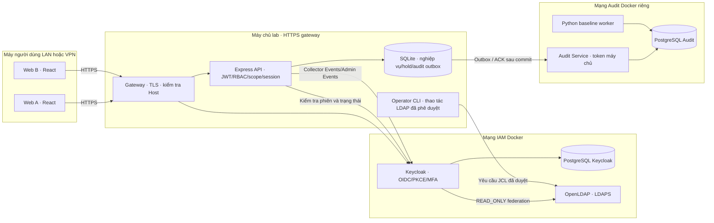
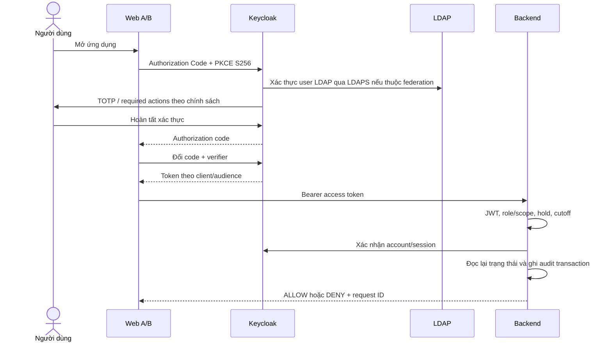
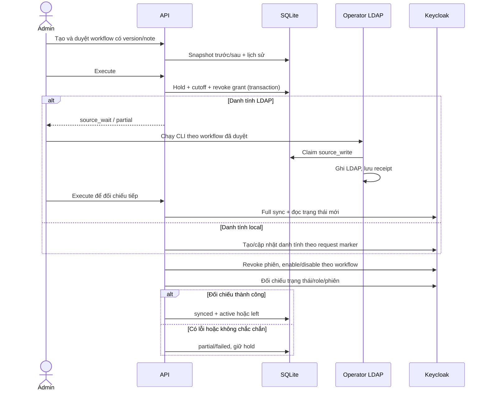
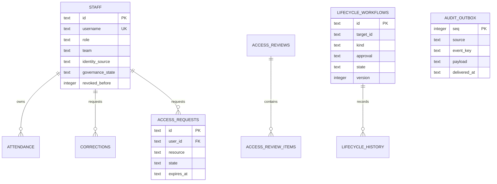
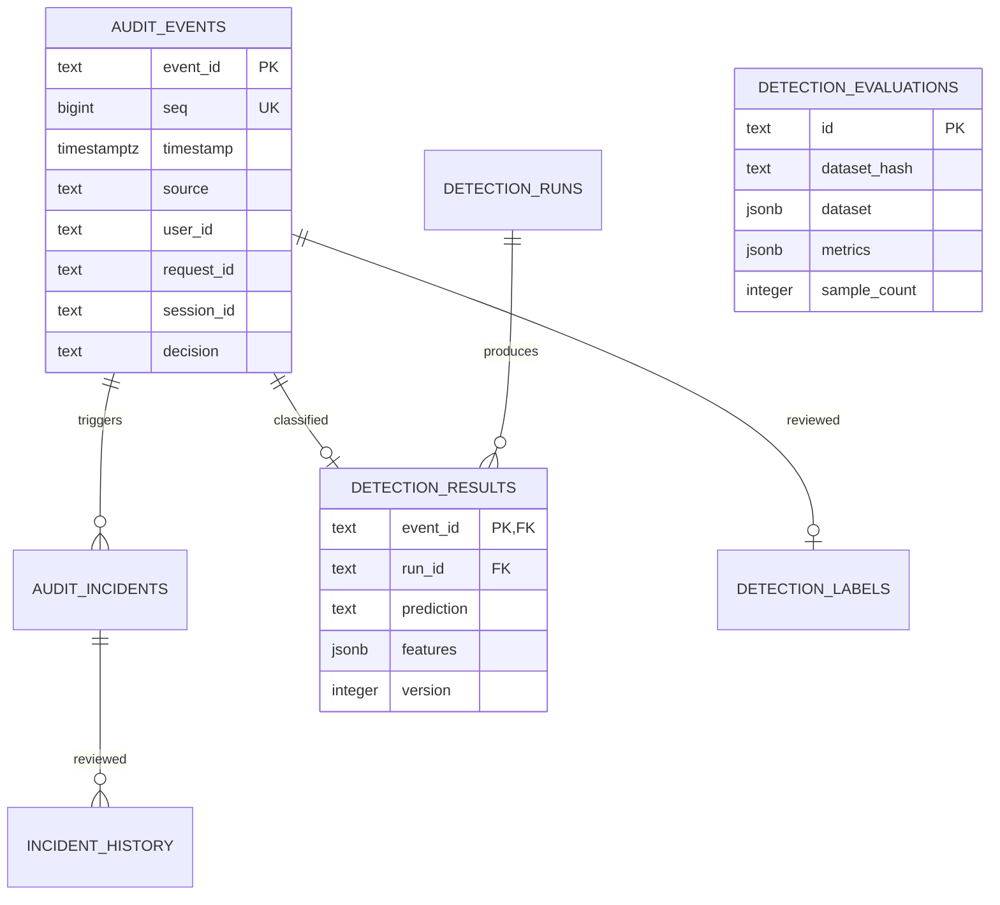

# Kiến trúc và luồng hệ thống Nhịp IAM

Tài liệu thiết kế theo mã nguồn tuần 5–10, cập nhật 07/11/2026. Sơ đồ là minh họa thiết kế, **không phải bằng chứng đã chạy**.

## Thành phần và ranh giới tin cậy



- Trình duyệt không giữ client secret, credential LDAP hay token Audit Service. UI chỉ hỗ trợ thao tác; API kiểm tra quyền lại.
- Máy thứ hai tin CA lab và truy cập gateway HTTPS chung. SSO chỉ chia sẻ phiên trong cùng hồ sơ trình duyệt; hai máy đăng nhập riêng, không chuyển cookie giữa máy.
- API chỉ tin loopback proxy, đọc `azp` để phân biệt Web A/B và giới hạn resource. JWT hợp lệ chưa đủ: còn role/scope, tài khoản active, required actions, phiên Keycloak, cutoff và hold vòng đời.
- Keycloak truy cập DB của chính nó; Audit Service dùng DB riêng. Collector gọi REST chính thức, không truy vấn bảng nội bộ Keycloak.
- LDAP là nguồn danh tính cho user LDAP. Ghi Join/Change/Leave qua CLI operator theo workflow; Keycloak federation vẫn READ_ONLY.
- Local hold giúp fail-closed khi nhiều hệ thống cập nhật chưa đồng bộ. Không có transaction phân tán giữa SQLite/LDAP/Keycloak.

## OIDC, MFA và truy cập API



## SSO và logout

```mermaid
sequenceDiagram
  participant A as Web A
  participant K as Keycloak
  participant B as Web B
  participant P as Backend
  A->>K: Đã có phiên SSO trong hồ sơ trình duyệt
  A->>B: Chuyển ứng dụng
  B->>K: Authorize cho client Web B
  K-->>B: Phiên SSO hợp lệ; vẫn áp dụng required actions
  B->>P: Gọi API Web B
  P-->>B: Chỉ admin/auditor đúng scope
  A->>K: Logout hoặc revoke phiên
  B->>P: Yêu cầu kế tiếp với token cũ
  P->>K: Kiểm tra sid (cache có giới hạn)
  P-->>B: SESSION_REVOKED / yêu cầu đăng nhập lại
```

## Join, Change, Leave



## Audit và phát hiện

```mermaid
sequenceDiagram
  participant API
  participant SQ as SQLite outbox
  participant AU as Audit Service
  participant PG as Audit PostgreSQL
  participant PY as Python worker
  participant B as Web B
  API->>SQ: Event + outbox cùng transaction
  API->>AU: Batch với event_id ổn định
  AU->>PG: INSERT ON CONFLICT + rule incidents
  PG-->>AU: Commit
  AU-->>API: ACK accepted
  API->>SQ: Đánh dấu đã gửi
  Note over API,PG: Mất ACK thì gửi lại cùng ID; không tự bỏ dữ liệu lỗi
  PY->>PG: Đọc batch sau checkpoint + features event-time
  PY->>PG: Kết quả/incident/checkpoint cùng transaction
  B->>API: Tra cứu hoặc review có role
  API->>AU: Truy vấn nội bộ bằng token máy chủ
  AU-->>B: Qua API: log/Normal/Anomaly/history
```

## ERD các bảng chính

Hai sơ đồ thuộc hai kho độc lập; user_id ở Audit là tham chiếu logic tới subject Keycloak, không phải foreign key xuyên database.





## Quyết định và giới hạn thiết kế

Chọn SQLite cho nghiệp vụ đang có, PostgreSQL riêng cho audit để chuyển đổi từng phần. Outbox tránh phụ thuộc tức thời vào availability của Audit Service nhưng cần dung lượng đĩa và backup. Retention, replay, late events, cache và restore phải được đo kiểm; chưa có số liệu đảm bảo không mất log, hiệu năng hoặc HA. Đây là mô hình IAM theo hướng Zero Trust, chưa phải triển khai đầy đủ kiến trúc Zero Trust doanh nghiệp.
