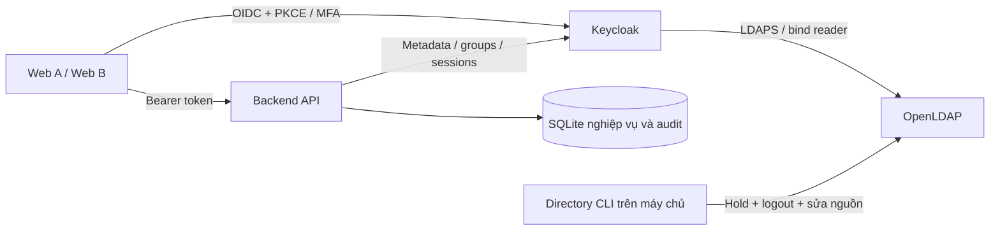

# Tuần 6 — LDAP/OpenLDAP và nguồn danh tính doanh nghiệp

## Note kiểm thử bổ sung — 08/11/2026

LDAP full sync 4 tài khoản ban đầu; LDAP employee/auditor đăng nhập MFA/SSO; chuyển nhóm và Leave qua JCL nguồn thật; mất LDAP chặn truy cập, đăng nhập lại được sau phục hồi.

Chi tiết: [kết quả thực tế](KET_QUA_KIEM_THU_2026_11_08.md). Các đoạn “chưa kiểm thử” bên dưới là ghi chép tại thời điểm triển khai source trước đây.


Cập nhật **06/11/2026 (UTC+7)** theo phần tuần 6 của [tuanconlai.md](../tuanconlai.md).

**Trạng thái: đã bổ sung mã nguồn/cấu hình; chưa build, kiểm thử hoặc áp dụng lên lab.** Chưa chạy Docker/OpenLDAP, script chuẩn bị/setup, đồng bộ thật, đăng nhập LDAP/MFA hoặc chụp minh chứng. Chỉ sao lưu mã nguồn HEAD trước thay đổi tại `backups/week6-source-before-20261106.zip`. Các kết quả 97/97 hoặc số pass cũ không xác nhận mã tuần 5/6.

Phạm vi đợt này dừng ở tuần 6. Không triển khai Access Governance tuần 7, Audit PostgreSQL tuần 8 hoặc Python Detection tuần 9. Tuần 5 đã có mã nguồn riêng, vẫn chờ nghiệm thu; xem [triển khai tuần 5](TUAN_5_TRIEN_KHAI.md).

## 1. Kiến trúc và quyết định nguồn dữ liệu



Chọn **OpenLDAP trong Docker**, kết nối **LDAPS**, chế độ **READ_ONLY**. LDAP là nguồn của username, email, họ tên, nhóm và trạng thái; mật khẩu được kiểm tra tại LDAP. Keycloak quản lý xác thực, OTP và phiên; SQLite lưu hồ sơ ứng dụng và trạng thái khóa riêng. Cách chọn quyền ghi dựa trên [hướng dẫn LDAP Federation của Keycloak](https://github.com/keycloak/keycloak/blob/26.8.0/docs/documentation/server_admin/topics/user-federation/ldap.adoc).

Không có cơ chế dự phòng mật khẩu local khi LDAP lỗi. Không xóa hồ sơ/chấm công/audit cũ khi nguồn không trả dữ liệu. Hạ tầng dùng TLS và tài khoản bind riêng, theo các cơ chế trong [OpenLDAP Security Considerations](https://www.openldap.org/doc/admin26/security.html).

## 2. Phần đã chuẩn bị

| Phần | Mã nguồn/cấu hình | Tình trạng hiện tại |
|---|---|---|
| OpenLDAP | Dockerfile Debian + slapd/ldap-utils, bootstrap một lần cho volume mới | Chưa build/chạy |
| LDAPS | CA riêng, certificate có SAN ldap/localhost/127.0.0.1, chỉ publish loopback 1636 | Chưa sinh chứng chỉ hoặc kết nối |
| ACL | Reader chỉ đọc thuộc tính, không đọc password hash; người disabled không được password bind | Chưa kiểm thử ACL/bind |
| Cấu trúc | Base DN, people/services/groups, 4 tài khoản LDAP mẫu tách khỏi 6 tài khoản local | Chỉ có cấu hình/generator |
| Federation | READ_ONLY, NO_CACHE, mappers thuộc tính và nhóm riêng dưới /directory | Chưa áp dụng Keycloak |
| Quyền | employees→employee, managers→manager, auditors→auditor; không ánh xạ admin | Chưa đăng nhập xác nhận |
| Hồ sơ local | Provision theo subject đã xác minh và metadata nguồn; giữ khóa riêng ở ứng dụng | Chưa chạy migration/provision |
| Đồng bộ | Job full/changed, journal, trạng thái, polling, kiểm soát lỗi/quét chưa đầy đủ | Chưa chạy job thật |
| Chuyển nhóm/disable | CLI tạo maintenance hold, thu hồi phiên rồi đổi LDAP, chờ sync đối chiếu | Chưa thay đổi tài khoản thật |
| Web B | Directory Users, Federation Sync, Group Mapping, tìm/lọc/phân trang/lịch sử | Chưa build/preview |
| Web A/B | Nhận diện nguồn LDAP; chặn sửa hồ sơ/mật khẩu local đối với user LDAP | Chưa kiểm thử API/trình duyệt |
| Vận hành | Backup LDAP + Keycloak + SQLite, runner riêng và rollback cấu hình | Chưa chạy backup dữ liệu/restore |

## 3. Thư mục và ánh xạ

```text
dc=company,dc=local
├── ou=people
│   ├── uid=ldap-employee01
│   ├── uid=ldap-employee02
│   ├── uid=ldap-manager01
│   └── uid=ldap-auditor01
├── ou=services
│   └── cn=keycloak-reader
└── ou=groups
    ├── cn=employees
    ├── cn=managers
    └── cn=auditors
```

| Nhóm nguồn | Nhóm Keycloak | Role | Quyền ứng dụng |
|---|---|---|---|
| employees | /directory/employees | employee | Web A, dữ liệu cá nhân |
| managers | /directory/managers | manager | Web A, cá nhân và nhóm cùng ou |
| auditors | /directory/auditors | auditor | Web A/B giám sát chỉ đọc; không xử lý user |

`ou` là nhóm nghiệp vụ, `employeeType=active|disabled` là trạng thái và `businessCategory=true` là cờ yêu cầu MFA. Các attribute `nhip.directory.team`, `nhip.directory.status`, `nhip.mfa.required` ở Keycloak được khai báo chỉ cho admin chỉnh/view; mapper luôn đọc từ LDAP. Không cho người dùng tự bỏ cờ MFA bằng trang hồ sơ.

Các tài khoản mẫu dùng prefix `ldap-`, không sửa employee01/admin01… đang có. Mỗi người phải thuộc đúng một nhóm quyền được cấu hình. Thiếu nhóm, nhiều nhóm, role trực tiếp trên user hoặc nhóm chứa quyền khác kỳ vọng dẫn đến trạng thái conflict. Backend không cấp admin từ nguồn LDAP và vẫn đối chiếu role trên token.

## 4. Áp dụng sau khi bạn yêu cầu chạy

**Các lệnh dưới chỉ là hướng dẫn, chưa thực thi trong đợt này.** Cần nền tuần 4, dependencies hiện có, Docker Desktop, Node 22.19+, Python 3.11+ và OpenSSL. Không thêm gói npm/pip mới.

### 4.1. Chuẩn bị LDAPS và OpenLDAP

Dừng runner/backend trước khi đổi cấu hình. Không dùng `down -v` hoặc xóa volume để “thử lại”.

```powershell
cd D:\IAM-ZeroTrust
python scripts/prepare_week6.py
docker compose -f docker-compose.yml -f directory/compose.week6.yml up -d --build
```

Generator giữ credential đã có, tạo `.local/credentials.json`, LDIF chứa hash SSHA và cert/key khi thiếu. Các tệp riêng nằm trong `directory/.local`, được Git và Docker build context bỏ qua. Certificate CA công khai có thể được mount vào truststore; private key/credential không mount vào Keycloak.

Keycloak nhận `KC_TRUSTSTORE_PATHS` từ Compose overlay. Cách nạp CA qua file PEM được mô tả trong [Keycloak Truststore](https://www.keycloak.org/server/keycloak-truststore). LDAPS chỉ mở trên `127.0.0.1:1636` ở máy chủ và `ldap:636` trong mạng Docker. Không mở LDAP trên Wi-Fi/LAN.

### 4.2. Hoàn tất nền MFA tuần 5 trước

Nếu chưa áp dụng flow tuần 5, thực hiện theo tài liệu tuần 5 trong một lượt vận hành có backup:

```powershell
python scripts/setup_week5.py
```

Script tuần 6 yêu cầu **cả hai client** đang override Browser Flow `nhip-week5-browser`; nếu chưa có sẽ dừng. Không tự sửa flow để vượt qua điều kiện này. Các user LDAP mới dùng cờ MFA từ nguồn; cần đăng ký OTP thật trong Keycloak trước khi nhận quyền API.

### 4.3. Khai báo federation và nhóm

```powershell
python scripts/setup_week6.py
```

Script lấy backup trước khi đổi cấu hình, giữ provider disabled trong lúc dựng mapper/nhóm rồi mới bật khi cấu hình xong. Thao tác sửa provider/group/profile chỉ chạy bằng quyền quản trị trong CLI, không mở endpoint tùy ý cho trình duyệt. Admin Events representation được tắt trước khi gửi bind credential để tránh ghi cấu hình nhạy cảm vào audit representation.

Backend `.env` nhận `DIRECTORY_COMPONENT_ID` và chu kỳ sync 300 giây. Không tự cấp thêm `manage-realm` cho service account. Runtime dùng các quyền quản trị user/đọc cấu hình hiện có; nếu phiên bản Keycloak không cho phép đọc/sync với quyền đó, API/job phải báo lỗi để đối chiếu sau, không tự tăng quyền hoặc báo thành công.

Script chưa gọi test LDAP connection/authentication, chưa trigger full sync và chưa đăng ký OTP. API federation/sync và các cấu hình mapper được đối chiếu với [Keycloak Admin CLI](https://www.keycloak.org/docs/26.4.7/server_admin/index.html#_admin_cli) và [mã GroupMapperConfig 26.8.0](https://github.com/keycloak/keycloak/blob/26.8.0/federation/ldap/src/main/java/org/keycloak/storage/ldap/mappers/membership/group/GroupMapperConfig.java); khả năng vận hành vẫn chờ nghiệm thu.

### 4.4. Chạy ứng dụng tuần 6

```powershell
python scripts/run_week6.py --network
```

Chỉ dùng `--network` nếu đã cấu hình HTTPS LAN; chế độ localhost bỏ cờ này. Runner LAN **có build** hai frontend khi bạn chủ động chạy. Runner không seed lại users/flow và không tự gọi setup/test; backend bắt đầu chu kỳ sync đã cấu hình sau khi khởi động.

Không dùng runner tuần 3/5 để tiếp tục chạy một lab đã áp dụng LDAP: Compose gốc có thể bỏ truststore overlay khi recreate Keycloak. Khi cần quay lại, rollback có chủ đích rồi mới dùng runner cũ.

Admin vào Web B → **Đồng bộ thư mục** → **Đồng bộ LDAP** → chọn full, nhập lý do và xác nhận. HTTP 202 chỉ có nghĩa đã xếp job. Đợi trạng thái cuối và đối chiếu Directory Users. Tài khoản LDAP mới có thể provision theo subject đã được Keycloak xác minh; nguồn/group không hợp lệ không được nhận quyền ứng dụng.

## 5. Năm API mới

| API | Quyền | Dữ liệu/hành vi |
|---|---|---|
| `GET /api/security/directory` | Admin, auditor | Cấu hình an toàn, trạng thái đã quan sát, số hồ sơ, job gần nhất |
| `GET /api/security/directory/users` | Admin, auditor | q/state/page/limit; hồ sơ local từ đúng provider |
| `GET /api/security/directory/mappings` | Admin, auditor | Nhóm LDAP → nhóm Keycloak → role/tài nguyên |
| `GET /api/security/directory/jobs` | Admin, auditor | 50 job gần nhất; imported/updated/blocked/error và ghi chú |
| `POST /api/security/directory/sync` | Admin | mode full/changed, note 10–300 ký tự; trả job PENDING |

`users` giới hạn 1–100 dòng/lượt. Không có API sửa URL LDAP, Bind DN, bind password, CA hoặc mapper tùy ý. Không trả component config nguyên bản, password hash, bind credential, OTP secret hoặc token.

Sửa hồ sơ/mật khẩu local cho user LDAP bị từ chối `DIRECTORY_READ_ONLY` và được ẩn trên UI. Khóa riêng/thu hồi phiên ứng dụng vẫn có; mở lại yêu cầu nguồn LDAP active và ánh xạ hợp lệ. Recovery OTP giữ luồng xác minh tuần 5, không xóa cờ MFA ở nguồn.

## 6. Đồng bộ, thu hồi và xử lý lỗi

- `READ_ONLY` và `NO_CACHE` tại provider; cache metadata backend tối đa 5 giây. Lỗi đọc nguồn không được cache thành thành công.
- Full/changed sync chạy nền; job pending/running có khóa theo provider. Audit và enqueue được ghi trong cùng transaction. Sau restart, job chưa xác nhận chuyển partial, không coi là xong.
- Sau LDAP sync, đối chiếu toàn bộ user được import trong giới hạn quét **10.000 người của realm**. Đây là giới hạn an toàn, chưa phải hệ thống đồng bộ danh tính quy mô lớn.
- Changed sync vẫn đọc lại nhóm của các user đã import vì thay đổi member của nhóm có thể không làm đổi modifyTimestamp của user.
- Thiếu hồ sơ ở nguồn chỉ được gắn missing sau một lượt quét đầy đủ, không lỗi hoặc ignored. Khi nguồn lỗi, không suy ra tất cả đã bị xóa.
- Thay đổi username/họ tên/nhóm/role/trạng thái sẽ đặt mốc thu hồi, logout và đối chiếu lại. Nếu logout chưa xác nhận, giữ pending. Khóa riêng ở ứng dụng không tự bị gỡ khi LDAP active trở lại.
- Disabled hợp lệ có thể được đồng bộ thành công nhưng vẫn ghi blocked. Conflict/missing/lỗi hoặc quét chưa đủ tạo partial. Không dùng biểu tượng xanh chỉ vì HTTP đọc cấu hình trả 200.
- `connection=keycloak_reachable` chỉ xác nhận đọc được cấu hình Keycloak, không chứng minh LDAP bind. Xem trạng thái/mốc thời gian của job; không có phép đo uptime LDAP riêng được giả lập.
- Các schema SQLite là bổ sung; không kéo audit sang PostgreSQL trong tuần 6.

## 7. Chuyển nhóm hoặc vô hiệu hóa tại nguồn

Chỉ thực hiện sau khi user đã được nhập và có hồ sơ trong Directory. Script cần chạy trên máy chủ, dùng credential riêng đã sinh; không truyền mật khẩu trong command line.

```powershell
python scripts/directory_user.py ldap-employee01 --team "Vận hành" --group managers --note "Chuyển bộ phận và nhiệm vụ đã được xác nhận."
python scripts/directory_user.py ldap-employee02 --disable --note "Tạm vô hiệu hóa danh tính tại nguồn thư mục."
```

Sau đó dùng **Đồng bộ LDAP → full** trên Web B và yêu cầu người dùng đăng nhập lại. Khi cần khôi phục nguồn, dùng `--enable` với lý do; lệnh này không tự mở khóa riêng ở ứng dụng.

CLI đặt maintenance hold và mốc thu hồi trước khi sửa; logout phiên cũ; LDAP giữ riêng các thao tác sửa mỗi entry. Bảng `directory_maintenance` chặn sync giải phóng hold khi thao tác ghi vẫn đang chạy. Các CLI sửa nhóm được tuần tự hóa trong SQLite để hạn chế ghi đè member của nhau.

Nếu thao tác nguồn lỗi, hold giữ nguyên. Sau khi kiểm tra và dừng tiến trình cũ, có thể chạy lại ý định đầy đủ với `--resume`; không dùng cờ này khi tiến trình trước vẫn chạy. CLI xong chuyển ready, đồng bộ mới giải phóng hold. Không có nút “bỏ qua nguồn” trên Web.

Không có giao dịch phân tán giữa LDAP–Keycloak–SQLite; không hỗ trợ nhiều operator sửa trực tiếp LDAP song song ngoài công cụ. Quyền của yêu cầu đã được chấp nhận trước mốc thu hồi không tự hoàn tác; cần đo lại độ trễ cache/thu hồi khi nghiệm thu.

## 8. Backup và rollback

```powershell
python scripts/backup_week6.py
```

Backup gồm dump Keycloak, SQLite Backup API, `slapcat` LDAP, cấu hình federation/group/profile và private files, có manifest SHA-256/scope tuần 6. Dữ liệu là các snapshot riêng; dừng các tác vụ ghi nếu cần mốc phục hồi chung. Backup chứa bí mật và phải giữ riêng trong `backups/`.

Để rollback **cấu hình federation**, dừng backend/runner và truyền đúng thư mục backup đã tạo:

```powershell
python scripts/restore_week6.py backups/THU_MUC_BACKUP_THUC_TE
```

Script xác minh manifest, quarantine hồ sơ LDAP, tắt provider trước và khôi phục cấu hình provider/mappers cũ nếu đã tồn tại, rồi phục hồi biến môi trường cũ. Giữ LDAP data, namespace nhóm, schema, audit, attendance, OTP credential và mốc thu hồi; **không phải** restore dữ liệu LDAP/SQLite toàn bộ. Hồ sơ bị quarantine cần được đối chiếu và mở lại có chủ đích. Với khôi phục dữ liệu LDAP, dùng `directory.ldif` trong một quy trình riêng vào volume mới, không tự xóa volume đang dùng.

## 9. Danh mục tệp chính

| Tệp | Vai trò |
|---|---|
| `directory/directory-config.json` | DN, users demo và ánh xạ nhóm/tài nguyên |
| `directory/Dockerfile`, `entrypoint.sh`, `slapd.conf.template` | OpenLDAP, ACL và khởi tạo volume |
| `directory/compose.week6.yml` | Overlay LDAPS và truststore Keycloak |
| `scripts/prepare_week6.py`, `setup_week6.py` | Chuẩn bị private files và cấu hình federation |
| `scripts/directory_user.py` | Đổi nhóm/trạng thái tại nguồn có maintenance hold |
| `scripts/backup_week6.py`, `restore_week6.py`, `run_week6.py` | Vận hành có chủ đích |
| `backend/directory.js` | Provision, kiểm tra nguồn, jobs, đồng bộ và 5 API |
| `backend/app.js`, `server.js`, `store.js` | Tích hợp middleware, scheduler và migration |
| `backend/keycloak-admin.js`, `operations.js`, `week5.js` | Metadata, sync và guard READ_ONLY |
| `shared/directory.jsx`, `directory.css`, `web-b/src/App.jsx` | Ba màn hình LDAP |
| `shared/operations.jsx`, `admin.jsx`, `session.mjs` | Nhận diện nguồn, giới hạn thao tác và hết quyền |

## 10. Chưa nghiệm thu

Chưa biết build có đạt hay không; chưa đo tài nguyên Docker, xác nhận LDAPS/ACL, quyền runtime service, group mapper, LDAP password bind, MFA/SSO, cache/thu hồi, outage, rollback, desktop/mobile. Chưa có minh chứng đăng nhập LDAP hoặc kiểm tra từ máy thứ hai. Dùng [danh sách nghiệm thu tuần 6](TUAN_6_NGHIEM_THU.md) khi bạn yêu cầu kiểm thử.
