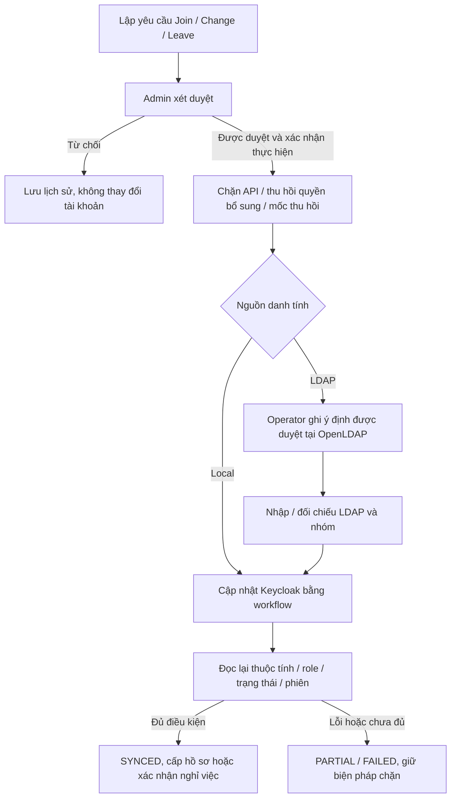

# Tuần 7 — Join / Change / Leave và Access Governance

## Note kiểm thử bổ sung — 08/11/2026

JCL local 24/24, LDAP 23/23; grant phê duyệt mở quyền, Change thu hồi grant/phiên, Leave chặn token. Các ca lỗi/hold/version được kiểm thử hồi quy.

Chi tiết: [kết quả thực tế](KET_QUA_KIEM_THU_2026_11_08.md). Các đoạn “chưa kiểm thử” bên dưới là ghi chép tại thời điểm triển khai source trước đây.


Cập nhật **06/11/2026 (UTC+7)** theo mục tuần 7 của [tuanconlai.md](../tuanconlai.md).

**Trạng thái: đã bổ sung mã nguồn, chưa build, kiểm thử hoặc áp dụng lên lab.** Không chạy Docker, backend/frontend, setup, LDAP CLI, đồng bộ, đăng nhập hoặc chụp minh chứng trong đợt này. Mã tuần 5/6 vẫn chưa nghiệm thu. Những số pass của các đợt trước không xác nhận tuần 7.

Phạm vi dừng tại tuần 7. Không chuyển audit sang PostgreSQL tuần 8 hoặc triển khai detection tuần 9. Giữ giao diện và CRUD hiện có, bổ sung quy trình quản trị bên cạnh chúng.

## 1. Quy trình và nguồn dữ liệu



- LDAP vẫn **READ_ONLY ở Keycloak**. Backend không nhận bind admin credential, không mở API ghi LDAP tùy ý và không đổi provider sang WRITABLE.
- Quy trình LDAP ghi ý định qua công cụ operator `scripts/process_governance.py`. Đây là một bước vận hành rõ ràng, không phải nút web đã ngầm sửa LDAP. Sau khi ghi nguồn, phải quay lại Web B đối chiếu.
- Các lệnh đọc/cập nhật user, required actions, role, logout và sessions sử dụng [Keycloak Admin REST API 26.8.0](https://www.keycloak.org/docs-api/26.8.0/rest-api/index.html). Các lựa chọn READ_ONLY, thuộc tính và mật khẩu nguồn cần tuân theo [hướng dẫn user federation của Keycloak](https://www.keycloak.org/docs/latest/server_admin/index.html#_user-storage-federation).
- Một admin có thể lập rồi phê duyệt JCL trong hai bước riêng để phù hợp lab hiện có một admin; **chưa có chính sách bắt buộc hai admin độc lập**. Admin không xử lý JCL cho chính mình hoặc tài khoản admin khác. Access Request tuyệt đối không tự duyệt.

## 2. Join — gia nhập

Join mặc định chỉ cấp **employee**. Muốn manager/auditor phải lập Change riêng sau đó; không cấp admin qua workflow.

### Local

1. Admin nhập username, họ tên, email, phòng ban và lý do, chưa nhập mật khẩu ở bước lập yêu cầu.
2. Phê duyệt rồi xác nhận thực hiện; lần tạo đầu nhập mật khẩu tạm thời 12–128 ký tự gồm hoa/thường/số.
3. Keycloak tạo user disabled với marker riêng `nhip.join.request`, cờ MFA và `UPDATE_PASSWORD` + `CONFIGURE_TOTP`.
4. Ghi hồ sơ ứng dụng ở trạng thái onboarding, cập nhật role, thu hồi phiên, bật tài khoản và đọc lại.
5. Chỉ khi đối chiếu đủ mới chuyển ứng dụng sang active. Người dùng phải hoàn tất mật khẩu/OTP trước khi API cho phép truy cập.

Mật khẩu chỉ đi trong request thực hiện và bộ nhớ tác vụ, không lưu vào SQLite, history, desired JSON hoặc thông báo. Nếu kết nối đứt sau khi user được tạo, retry chỉ nhận user có đúng marker yêu cầu và đúng nguồn local; không nhận tài khoản trùng tên không liên quan. Không tự reset mật khẩu khi retry. Lần retry có thể để trống mật khẩu nếu user đã tồn tại đúng marker.

### OpenLDAP

Username phải có prefix `ldap-`. Sau lần thực hiện đầu, workflow chờ source. Operator chạy:

```powershell
python scripts/process_governance.py MA_QUY_TRINH
```

Công cụ tạo entry disabled với marker nguồn, ánh xạ nhóm employees, sau đó thay mật khẩu và kích hoạt nguồn theo ý định đã duyệt. **Người nhận tự chọn mật khẩu cuối bằng getpass tại máy chủ**, không đưa mật khẩu LDAP lên web, argv hoặc lịch sử. Mật khẩu bootstrap khi entry disabled không dùng để đăng nhập. LDAP READ_ONLY không hỗ trợ ép người dùng đổi mật khẩu LDAP bằng `UPDATE_PASSWORD` trong Keycloak; việc thiết lập/thay mật khẩu được hoàn tất ở nguồn trước khi bật, còn Keycloak buộc `CONFIGURE_TOTP`.

Đây là quy trình enrollment trực tiếp tại máy chủ cho lab, chưa có cổng tự phục vụ đổi mật khẩu LDAP hoặc tích hợp email. Không mô tả nó là màn hình đổi mật khẩu LDAP trong Keycloak. Người dùng cần phối hợp operator để nhập mật khẩu riêng.

Sau ghi nguồn, backend nhập LDAP, xác nhận provider/subject, nhóm và thuộc tính; user được provision sớm bởi sync/login vẫn mang onboarding khi Join chưa SYNCED. Không tự cấp truy cập bằng một lượt sync Directory độc lập.

## 3. Change — đổi phòng ban / quyền

- Chỉ xử lý tài khoản đang active và không bị khóa riêng. Bản yêu cầu chụp hồ sơ trước thay đổi; nếu hồ sơ đã đổi trước lần thực hiện đầu, cần từ chối và lập yêu cầu mới.
- Local: cập nhật họ tên/email, phòng ban ứng dụng và business role trong Keycloak; xóa role trực tiếp cũ trước khi cấp role mới. Role hiệu lực được đọc lại để phát hiện quyền kế thừa không khớp.
- LDAP: công cụ nguồn sửa `ou` và membership của ba nhóm quản lý trong tuần 6, rồi backend nhập/đối chiếu lại. Họ tên/email được giữ theo nguồn; thay hai thuộc tính này không nằm trong Change LDAP của tuần 7.
- Ngay khi bắt đầu thực hiện: đặt `governance_state=processing`, mốc thu hồi và thu hồi/hủy các quyền bổ sung đang có hoặc đang chờ.
- Chỉ đưa về active khi LDAP (nếu có), hồ sơ, effective business role, trạng thái Keycloak và phiên cũ đúng kỳ vọng. Khi cần đăng nhập lại, token cũ bị chặn bởi mốc thu hồi và role mới.

## 4. Leave — nghỉ việc

Khi thực hiện Leave, ứng dụng khóa ngay và đặt processing trước thao tác từ xa. Local disable + logout tại Keycloak. LDAP cần operator đặt trạng thái disabled tại nguồn rồi backend xác nhận và disable Keycloak.

Hoàn tất chuyển `governance_state=left`, giữ disabled và mốc thu hồi; không xóa hồ sơ, attendance, audit hoặc history. API và thao tác mở khóa cũ không được vượt qua trạng thái left. **Chưa có luồng tái tuyển dụng**; không sử dụng Enable để giả lập rehire.

## 5. Yêu cầu quyền và phê duyệt

Ba tài nguyên có API thực tế:

| Tài nguyên | Nội dung | Phạm vi / người duyệt |
|---|---|---|
| team-report | Tổng ngày công/giờ công 30 ngày gần nhất | Nhóm hiện tại; manager cùng nhóm hoặc admin |
| team-export | Báo cáo nhóm kèm nút CSV | Nhóm hiện tại; manager cùng nhóm hoặc admin |
| audit-report | Tổng yêu cầu ALLOW/DENY theo ngày của chính người xin | Chính mình; admin |

Nhân viên gửi lý do 10–500 ký tự, thời hạn 1–30 ngày. Không có nhiều yêu cầu pending/approved cho cùng user/tài nguyên. Quyền hết hạn được kiểm tra bằng thời gian máy chủ tại mỗi API, không dựa vào badge trên trình duyệt.

Manager chỉ duyệt/thu hồi báo cáo cho **employee cùng phòng ban**, không cấp role manager/auditor hoặc quyền Web B. Manager muốn xin cho chính mình phải được admin duyệt. Admin cũng không tự duyệt. Auditor không có quyền approve/revoke; auditor được tạo ảnh chụp và ghi khuyến nghị rà soát.

Phê duyệt đối chiếu lại tài khoản, trạng thái giữ chặn và phòng ban đã chụp. Grant còn phải khớp phòng ban hiện tại lúc sử dụng. Join/Change/Leave thu hồi grant và hủy pending trước khi xử lý. Quyền bổ sung là quyền ứng dụng, không thêm realm role hoặc cho employee vào Security Dashboard.

API báo cáo giới hạn 1.000 người; nếu vượt, trả `complete=false` và UI báo danh sách chưa đủ. CSV áp dụng cho dữ liệu báo cáo đã đọc, không xuất password/token/OTP/bind credential.

## 6. Rà soát và ma trận quyền

Admin/Auditor tạo đợt review với lý do, lưu snapshot thay vì chỉ render dữ liệu hiện tại. Các mục bao gồm vai trò mở rộng, MFA chưa bắt buộc, trạng thái hold, grant đang hoạt động/hết hạn/lệch phạm vi và đăng nhập đã quan sát.

Không có LOGIN đã lưu → **chưa đủ lịch sử**, không kết luận tài khoản không sử dụng. Có mốc LOGIN cũ hơn 30 ngày → cần rà soát dựa trên lịch sử collector đã quan sát, không phải bằng chứng đầy đủ về mức sử dụng. Mỗi đợt chụp tối đa 1.000 người và lưu cờ complete; danh sách đợt gần nhất giới hạn 50, mỗi trang chi tiết 20 mục.

Khuyến nghị giữ/thu hồi/xác minh không tự thay đổi tài khoản. Admin có thể xác nhận thu hồi grant qua API phê duyệt sẵn có; khóa/nghỉ việc phải đi qua JCL. Snapshot vẫn giữ nguyên sau xử lý để đối chiếu lịch sử. Ma trận mới hiển thị nguồn, vai trò, vòng đời, khóa riêng và grant có thời hạn bên cạnh ma trận tài nguyên tuần 5.

## 7. Trạng thái và khôi phục lỗi

| Trạng thái | Ý nghĩa |
|---|---|
| PENDING | Đã lập hoặc được duyệt, chưa xác nhận thực hiện |
| RUNNING | Backend hoặc source operator đang xử lý |
| PARTIAL | Chờ nguồn hoặc đã gửi thao tác nhưng chưa xác nhận đủ; giữ chặn |
| FAILED | Preflight dịch vụ thất bại trước lần ghi đầu; vẫn giữ biện pháp chặn đã đặt |
| SYNCED | Đã đọc lại trạng thái đích theo điều kiện quy trình; không đồng nghĩa đã nghiệm thu đăng nhập MFA |

- Ghi yêu cầu, phê duyệt, thực hiện, giữ chặn và audit trong transaction SQLite. Dùng version để chống bấm quyết định từ dữ liệu cũ; chỉ một JCL chưa kết thúc cho mỗi username.
- HTTP 202 là đã nhận xử lý, không phải hoàn tất. Dialog và bảng theo dõi RUNNING; có nút đọc hiện trạng riêng và refresh sau operator CLI.
- Khởi động lại backend: tác vụ backend RUNNING thành PARTIAL; tác vụ `source_write` giữ khóa vì CLI có thể vẫn chạy độc lập. Không tự bỏ khóa nguồn.
- Nếu CLI lỗi: hold vẫn giữ. Sau khi kiểm tra/dừng writer cũ, operator có thể dùng `--resume` cho cùng ý định đầy đủ. Không chạy hai writer song song hoặc dùng resume khi writer cũ còn hoạt động.
- CLI tuần 6 và CLI JCL kiểm tra khóa ghi nguồn chung. Sau source receipt, không phát lại thao tác nguồn; dùng đối chiếu từ Web B.
- Quy trình cũ sửa hồ sơ, reset password, recovery/retry hoặc enable không được mở danh tính đang processing/onboarding/left. Auth đọc lại hold/cutoff sau các await xác nhận từ Keycloak.
- Không có transaction phân tán LDAP–Keycloak–SQLite. Quyền của tác vụ đã được chấp nhận và chạy trước mốc chặn không thể tự hoàn tác. Không hỗ trợ nhiều backend cùng quản lý DB; không có watchdog tự replay tác vụ hoặc tự bỏ hold khi timeout.

## 8. Giao diện

**Web A:** Quyền truy cập của tôi, form xin quyền, xem phản hồi/thời hạn, rút pending, mở tài nguyên được cấp, CSV cho team-export và timeline JCL cá nhân. Manager/Admin có trang Duyệt quyền truy cập, lọc trạng thái/tìm kiếm/phân trang.

**Web B:** Vòng đời danh tính, tạo Join/Change/Leave, approval và execute riêng, so sánh trước/mục tiêu, đọc hiện trạng, timeline, hướng dẫn source operator, trạng thái đồng bộ. Thêm Phê duyệt quyền (admin), Rà soát quyền (admin/auditor), Vai trò & quyền bổ sung. Giữ hệ màu mint/blue, card, bảng, dialog và breakpoint mobile của hệ thống.

Thông báo nội bộ được tạo khi xin quyền, xét duyệt và hoàn tất JCL. Không tuyên bố đã gửi email/SMS. Người nghỉ việc không đọc được thông báo qua ứng dụng; audit và workflow vẫn phục vụ người quản trị.

## 9. API mới

| API | Quyền / chức năng |
|---|---|
| GET /api/me/access | Cá nhân: catalog, requests, grants và history |
| POST /api/me/access/requests | Cá nhân: xin quyền |
| POST /api/me/access/requests/:id/cancel | Cá nhân: rút pending của mình |
| GET /api/governance/approvals | Manager theo nhóm, admin toàn hệ thống |
| POST /api/governance/requests/:id/decision | Approve/reject/revoke, không tự duyệt |
| GET /api/access/resources/:resource | Cần grant đang có hiệu lực và token Web A |
| GET /api/security/governance | Admin/auditor: tổng quan và danh tính trong phạm vi |
| GET /api/security/governance/workflows | Admin/auditor: tìm/lọc/phân trang JCL |
| GET /api/security/governance/workflows/:id | Admin/auditor: chi tiết, trước/mục tiêu và history |
| GET /api/security/governance/workflows/:id/observed | Admin/auditor: đọc hiện trạng, không đổi trạng thái |
| POST /api/security/governance/workflows | Admin: lập JCL |
| POST /api/security/governance/workflows/:id/decision | Admin: xét duyệt với version |
| POST /api/security/governance/workflows/:id/execute | Admin: thực hiện / retry đối chiếu với version |
| POST /api/security/governance/reviews | Admin/auditor: snapshot review |
| GET /api/security/governance/reviews | Admin/auditor: các đợt review |
| GET /api/security/governance/reviews/:id | Admin/auditor: review phân trang |
| POST /api/security/governance/review-items/:id | Admin/auditor: ghi khuyến nghị |
| GET /api/security/governance/matrix | Admin/auditor: vai trò/grant/vòng đời |

Token Web B chỉ truy cập nhóm API được phép; resource nghiệp vụ mới dùng Web A. Các quyết định nhạy cảm vẫn có guard backend, không dựa vào việc ẩn nút.

## 10. Áp dụng khi được yêu cầu vận hành

**Chưa thực thi các lệnh dưới.** Hoàn tất nền tuần 5; nếu dùng LDAP, áp dụng tuần 6 trước và giữ Compose overlay LDAPS. Dừng runner/backend khi đổi cấu hình; không reseed realm hoặc xóa volume.

```powershell
cd D:\IAM-ZeroTrust
python scripts/setup_week7.py
python scripts/run_week7.py --network
```

Chỉ dùng `--network` nếu lab đang ở chế độ HTTPS LAN; localhost bỏ cờ. Setup lấy backup theo nguồn đã cấu hình, kiểm tra flow MFA tuần 5 và cờ admin-managed, sau đó khai báo correlation attribute riêng. Không tăng quyền service account. Runner không tự setup/seed/test; khi chủ động chạy ở LAN có build frontend và backend có collector/scheduler như tuần 6.

Setup tắt Admin Events representation trước các request có credential để tránh ghi body nhạy cảm. Join local kiểm tra metadata được bảo vệ và chính sách representation trước khi tạo; nếu chưa chuẩn bị đúng thì giữ yêu cầu chưa xác nhận, không ghi mật khẩu vào history.

Schema tuần 7 thêm `staff.governance_state`, `lifecycle_workflows`, `lifecycle_history`, `access_requests`, `access_reviews`, `access_review_items` khi backend được chạy sau này; không thay DB của lab trong đợt viết mã này.

## 11. Sao lưu / quay lại

Đã lưu checkpoint **mã nguồn working tree** tại `backups/week7-source-checkpoint-20261106.zip` sau bước thêm schema ban đầu; checkpoint gồm cả mã tuần 6 chưa commit. Đây không phải backup dữ liệu hoặc mốc source trước mọi thay đổi tuần 7.

Khi vận hành thực tế, backup trước: có LDAP dùng `scripts/backup_week6.py`, local dùng `scripts/backup_week5.py`. SQLite snapshot của các script này chứa các bảng tuần 7; backup chứa bí mật phải giữ riêng. Dừng tác vụ ghi để có mốc phục hồi chung giữa các kho dữ liệu.

Không có rollback một nút cho JCL đã ghi nguồn. Khi quay lại source cũ, không được chạy backend bỏ qua governance_state trên dữ liệu đang giữ chặn; trước đó cần quarantine các danh tính liên quan và thực hiện quy trình khôi phục có chủ đích. Không xóa history, tự đặt active hàng loạt hoặc dùng Enable để né hold. `restore_week6.py` chỉ rollback cấu hình federation, không đảo ngược Change/Leave, grant hoặc các bước JCL.

## 12. Bàn giao và giới hạn xác nhận

Mã chính: `backend/governance.js`, tích hợp store/auth/directory/keycloak-admin/legacy guards; `shared/governance.jsx` và CSS; menu Web A/B; `scripts/process_governance.py`, `setup_week7.py`, `run_week7.py`.

Chưa biết build/import/migration có đạt; chưa xác nhận quyền Admin REST của runtime, flow MFA, enroll LDAP, mapper, revoke, đồng thời, nguồn lỗi, restart, phân quyền, CSV hoặc hiển thị mobile. Không có minh chứng hoặc tỷ lệ pass tuần 7. Dùng [danh sách nghiệm thu tuần 7](TUAN_7_NGHIEM_THU.md) khi có yêu cầu kiểm thử.
